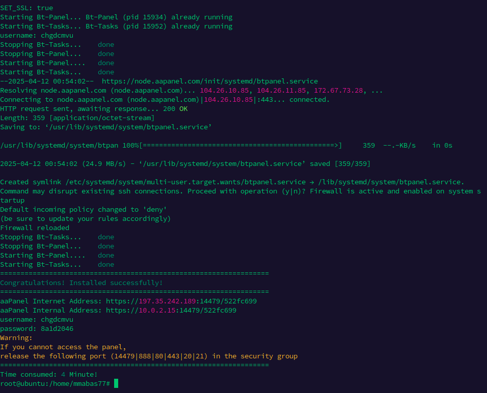

# Deploying a Node.js Application with MongoDB on aaPanel (Free Edition)

This guide provides step-by-step instructions on how to install aaPanel Free Edition, configure it with the Nginx stack, and deploy a Node.js application connected to a MongoDB database using a reverse proxy.

## Prerequisites

- A clean server with a supported Linux distribution (e.g., CentOS, Ubuntu, Debian).
- Root access to the server.
- A domain name pointed to your server's IP address.

## Step 1: Install aaPanel Free Edition

1. **Connect to Your Server:**
    - Use an SSH client (like PuTTY) to connect to your server as the root user.

2. **Update Your System:**
    - Before installing new software, ensure your system is up-to-date:
      ```bash
      sudo apt update && sudo apt upgrade -y
      ```

3. **Download and Run the Installation Script:**
    - Execute the following command to download and install aaPanel:
      ```bash
      URL=https://www.aapanel.com/script/install_7.0_en.sh && if [ -f /usr/bin/curl ];then curl -ksSO "$URL" ;else wget --no-check-certificate -O install_7.0_en.sh "$URL";fi;bash install_7.0_en.sh aapanel
      ```
    - During installation, you'll be prompted to choose the installation directory. Press `y` to accept the default.

4. **Access aaPanel:**
    - Once installed, aaPanel will provide a URL, username, and password. Open the provided URL in your browser and log in with the credentials.

    - 

## Step 2: Configure aaPanel with Nginx Stack

1. **Install Nginx:**
    - After logging into aaPanel, navigate to the "App Store."
    - Locate "Nginx" and click "Install."

2. **Install PHP and MySQL (Optional):**
    - If your application requires PHP or MySQL, install them from the "App Store" as well.

## Step 3: Install Node.js and PM2 Manager

1. **Install Node.js Version Manager:**
    - In the "App Store," search for "Node.js version manager."
    - Click "Install" to add it to your server.

2. **Install PM2 Manager:**
    - Still in the "App Store," search for "PM2 Manager."
    - Click "Install" to add it.

3. **Install Node.js:**
    - After installing the Node.js version manager, go to its "Settings."
    - Install the Node.js version required for your application.

## Step 4: Install and Configure MongoDB

1. **Install MongoDB:**
    - In the "App Store," find "MongoDB" and click "Install."
    - If you encounter issues installing MongoDB through aaPanel, you can install it manually by executing:
      ```bash
      bash /www/server/panel/install/mongodb.sh install 6.0
      ```
      Ensure you monitor the installation process for any errors. citeturn0search3

2. **Configure MongoDB to Accept External Connections:**
    - By default, MongoDB listens on `127.0.0.1`. To allow external connections:
        - Navigate to the MongoDB configuration settings in aaPanel.
        - Change the bind IP from `127.0.0.1` to `0.0.0.0`. citeturn0search27
    - Ensure that port `27017` (MongoDB's default port) is open in your server's firewall settings.


## Step 5.1: Deploy Your Node.js Application (First approach)

1. **Upload Your Application:**
    - Use aaPanel's "File" manager or FTP to upload your Node.js application files to your server.

2. **Add a Node.js Project:**
    - Navigate to "Websites" and click on "Add Site."
    - In the "Add Site" dialog:
        - **Domain Name:** Enter your domain (e.g., `example.com`).
        - **Root Directory:** Specify the directory where your application resides.
        - **Enable Node.js Project:** Check this option.
        - **Run Directory:** Set it to the directory containing your main application file (e.g., `/app`).
        - **Start-up File:** Enter the entry point of your application (e.g., `app.js`).
        - **Run Command:** Specify the command to start your app (e.g., `node app.js`).
        - **Version:** Select the Node.js version you installed earlier.
    - Click "Submit" to create the site.

3. **Start the Application with PM2:**
    - Navigate to "PM2 Manager."
    - Click on "Add Project."
    - Fill in the project details:
        - **Project Name:** A name for your project.
        - **Execution Path:** The path to your application's main file.
        - **Run Command:** The command to start your application (e.g., `node app.js`).
    - Click "Submit" to start the application.


Here's the updated section for your README file, incorporating your notes and highlighting that the app should be started via PM2 from the terminal before setting up the reverse proxy:

---

## Step 5.2: Set Up Nginx Reverse Proxy (Second Approach)

1. **Start Your Node.js App with PM2:**

   Before setting up the reverse proxy, ensure your Node.js app is running. Open your server’s terminal and navigate to your app directory:

   ```bash
   cd /path/to/your/app
   pm2 start app.js --name nodeapp
   ```

    - Replace `app.js` with your actual entry file.
    - `--name` gives your app an easy-to-remember label in PM2.

   Confirm the app is running:

   ```bash
   pm2 list
   ```

   You should see your app listed and marked as online.

2. **Configure Reverse Proxy in aaPanel:**
    - Navigate to **"Websites"** in the aaPanel dashboard.
    - Click on the domain associated with your Node.js app.
    - Go to the **"Reverse Proxy"** tab.
    - Click **"Add Reverse Proxy."**
    - Fill in the following fields:
        - **Proxy Name:** A recognizable name for the proxy (e.g., `nodeapp`).
        - **Target URL:** The internal address where your app is running, typically:
          ```
          http://127.0.0.1:3000
          ```
        - **Send Domain:** Enter your domain name (e.g., `example.com`).

    - Click **"Submit"** to save the configuration.

3. **Restart Nginx:**
    - Go to the **"Nginx"** section under **Installed Apps**.
    - Click **"Restart"** to apply the proxy settings.

Now your Node.js app should be accessible via your domain name through the Nginx reverse proxy.


Sure! Here’s how to add a domain to the `hosts` file, which is useful when testing a site locally before DNS is live or when using a custom domain during development.

---

## Step 6: Add Domain to `hosts` File (For Local Testing)

If your domain hasn't propagated yet, or you're using a custom domain (like `myapp.local`) for local development, you can manually point the domain to your server’s IP using your system’s `hosts` file.

### 1. **Find Your Server's IP Address**

Run this on your server:

```bash
curl ifconfig.me
```

Or check the IP in your server dashboard.

### 2. **Edit the `hosts` File**

Depending on your operating system:

#### 🖥️ Windows:

1. Open **Notepad as Administrator**.
2. Open the file:
   ```
   C:\Windows\System32\drivers\etc\hosts
   ```
3. Add a line at the bottom:
   ```
   YOUR.SERVER.IP    yourdomain.com
   ```

#### 🍎 macOS / 🐧 Linux:

1. Open a terminal.
2. Edit the hosts file using a text editor like nano:
   ```bash
   sudo nano /etc/hosts
   ```
3. Add the following line:
   ```
   YOUR.SERVER.IP    yourdomain.com
   ```

   Example:
   ```
   123.45.67.89    myapp.local
   ```

4. Save and exit (`Ctrl+O`, `Enter`, then `Ctrl+X` for nano).

### 3. **Flush DNS Cache (if needed)**

#### macOS:
```bash
sudo dscacheutil -flushcache; sudo killall -HUP mDNSResponder
```

#### Windows:
```cmd
ipconfig /flushdns
```

---

Now, when you access `yourdomain.com` in your browser, it will resolve to your server’s IP — even without DNS setup.


## Step 7: Test Your Application

- Open your domain in a web browser to verify that your Node.js application is running correctly and can interact with the MongoDB database.

## Additional Tips

- **SSL Certificates:** Use aaPanel's built-in tools to apply for and configure SSL certificates for your domain.
- **Firewall Settings:** Ensure that necessary ports (e.g., `80`, `443`, `27017`) are open in your server's firewall.
- **Monitoring:** Regularly monitor your application's performance and logs using aaPanel's monitoring tools.

By following these steps, you can successfully deploy a Node.js application with a MongoDB backend on aaPanel using the Nginx stack and reverse proxy. 